### Hi, I'm Abbyleigh 👋

I study Computer Science with AI at The Open University, run **Abboryn Digital**, and spend a lot of my time building things I want to see work.

## A bit about me

I'm learning software development properly while also getting stuck into real projects. Some days that's Python coursework; other days it's working out why a layout breaks on mobile, getting an API to behave, or spending far too long fixing one tiny detail.

I started **[Abboryn Digital](https://abboryndigital.co.uk)** because I wanted to turn what I'm learning into something of my own. I work on websites, custom software and automation, and I'm especially interested in how AI can be useful beyond just adding a chatbot to something.

I'm still learning. I don't pretend to know everything, but I do enjoy figuring things out.

## Things I've been working on

**[Abboryn Digital](https://abboryndigital.co.uk)** · [Private source repository](https://github.com/Abbyleigh/abboryn-digital-studio)

My digital studio and probably the project I spend the most time on. I'm building the website, improving its performance and search visibility, and developing tools to manage more of the business behind the scenes.

**[FastOne Labs](https://github.com/Abbyleigh/fastonelabs)** 🏎️ · [Live site](https://fastonelabs.pages.dev)

An F1 project where I get to combine coding with racing. It includes 3D circuit visuals, race data and experiments with strategy and pit-stop decisions. This one's been a good excuse to learn more about Three.js and working with live data.

**[SoloLedger](https://github.com/Abbyleigh/Sololedger)** · [Try the beta](https://sololedger-4lt.pages.dev/)

A finance tool I've been developing for UK sole traders. The idea is to make the boring admin a bit easier: tracking money in and out, managing customers and creating invoices.

**Business OS**

A bigger work-in-progress: building reusable software for managing different businesses, rather than starting from scratch every time. I'm currently working through the less glamorous but important parts, like accounts, permissions, databases and testing.

**[Safe Phase Electrical — website concept](https://github.com/Abbyleigh/safe-phase-electrical-concept)**

An unofficial redesign concept for an electrical contractor. I use projects like this to practise responsive layouts, clear navigation and building websites around what customers actually need.

## What I use

**Languages:** Python, TypeScript, JavaScript, HTML and CSS

**Frontend:** React, Vite and Three.js

**Backend and data:** FastAPI, REST APIs and PostgreSQL

**Other tools:** Git, GitHub, Cloudflare and Docker

I'm adding to this list as I go. A lot of what I know comes from needing to solve a problem in one of my projects, then going away and learning how to do it.

## Outside the code

I'm studying for my degree alongside running a business and raising my three kids, so there's rarely a quiet moment. 😅

I like being able to look back at something I couldn't do a few months ago and realise I can do it now. That's a big part of why I keep building.

---

**Have a look around, or see what I'm building at [Abboryn Digital](https://abboryndigital.co.uk).**

[Website](https://abboryndigital.co.uk) · [Instagram](https://www.instagram.com/abboryn.digital/) · [GitHub](https://github.com/Abbyleigh)

